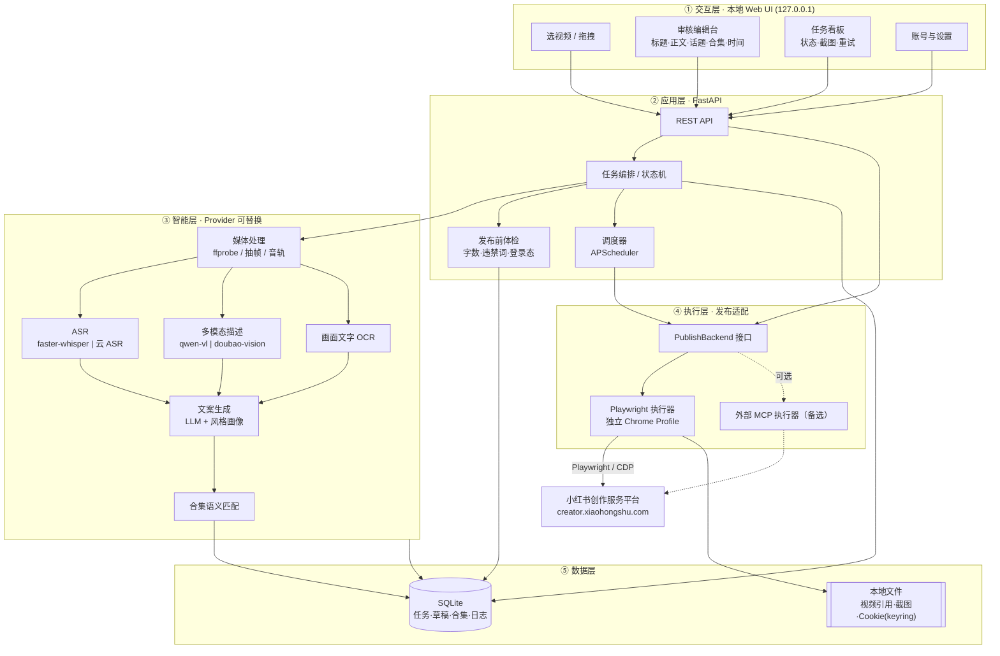
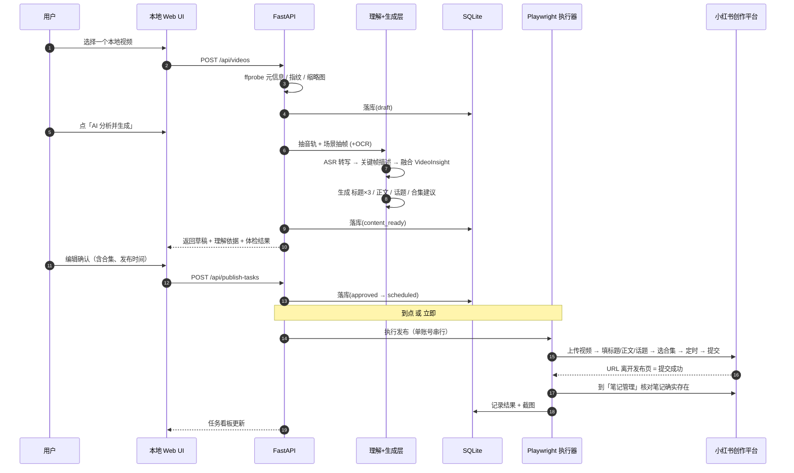
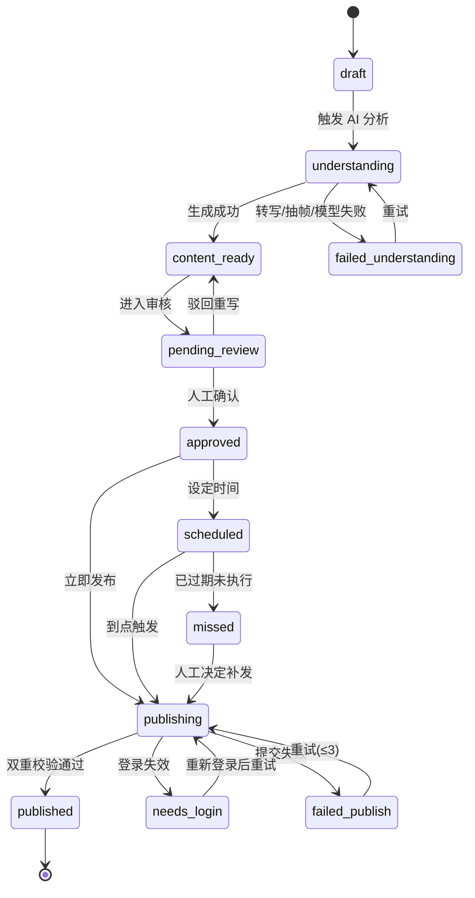

# at-ai-xhs · 小红书视频笔记 AI 发布工具 设计方案

> 版本：v0.1（草案，待评审）
> 定位：本地单机运行的个人创作助手，不做 SaaS、不做多账号矩阵。

---

## 0. 摘要

一句话：**你选一个本地视频文件，工具自动完成「看懂视频 → 写标题/正文/话题 → 推荐合集 → 按你指定的时间发布到小红书」，并在提交前保留一道人工确认闸门。**

四条原始需求的落地方式：

| 你的需求 | 实现方式 | 关键约束 |
| --- | --- | --- |
| 选择本地视频 | 本地 Web UI：文件选择器 / 拖拽 / 目录扫描；只存路径引用，不复制文件 | 单文件建议 ≤ 1GB |
| AI 识别标题与内容 | ASR 转写 + 关键帧多模态描述 + 画面文字 OCR → 结构化「视频理解包」→ LLM 生成文案 | 标题 ≤ 20 字、正文 ≤ 1000 字、话题 ≤ 10 个 |
| 自动选合集 | 抓取账号合集清单 → 语义匹配打分 → 阈值决策 → 拿不准就不选 | ⚠️ 合集 DOM 需 M0 逆向确认；已设计人工兜底 |
| 定时发布 | 默认用**平台原生定时**（提交后由平台托管），可选**本地调度器**到点执行 | 平台定时窗口 1 小时 ~ 14 天 |

**技术路线一句话**：用 Playwright 驱动一个独立 Chrome Profile 操作小红书**创作服务平台**（`creator.xiaohongshu.com`）完成发布。原因见 2.1：小红书开放平台没有面向个人创作者的「笔记发布」API。

### 关键设计决策

| # | 决策 | 理由 |
| --- | --- | --- |
| D1 | **浏览器自动化**而非官方 API | 开放平台类目只覆盖电商侧（商品/搬家/打单），不含笔记发布；分享 SDK 是给移动 App 用的，不适用桌面工具 |
| D2 | **发布执行器做成可替换后端**（Playwright / 外部 MCP） | 页面改版是最大风险，抽象成接口后可以快速切换或降级 |
| D3 | **人工审核闸门默认开启** | 自动发布 = 平台风控风险 + 内容风险，默认 `auto_publish=false` |
| D4 | **合集「不确定就不选」** | 进错合集对账号的伤害大于不进合集；宁可空着让用户点一下 |
| D5 | **定时默认走平台原生** | 本机可以关机、不依赖工具常驻；本地调度只作为「不想提前上传」时的备选 |
| D6 | **理解层与生成层都做 Provider 抽象** | ASR/多模态/文本模型都能换，避免被单一厂商锁死 |

---

## 1. 目标与范围

### 1.1 用户故事（本期必须支持）

- **US-1** 我在 UI 里选中本地一个视频文件，能看到它的缩略图与元信息（时长/分辨率/大小）。
- **US-2** 我点「AI 分析」，工具给出：3 个候选标题、1 篇正文、5–8 个话题标签，并显示它「看懂了什么」（转写摘要 + 关键帧描述）让我判断依据是否可靠。
- **US-3** 工具基于内容从我账号的合集里推荐 1 个合集，并告诉我为什么推荐它；我可以改选或选择「不加入」。
- **US-4** 我可以设置发布日期时间（1 小时 ~ 14 天内），到点自动出现在我的小红书主页。
- **US-5** 我能在提交前修改 AI 写的任何字段，并看到「发布前体检」结果（字数/违禁词/登录态/视频可读性）。
- **US-6** 发布失败时我能看到失败原因和当时的页面截图，并能一键重试，而不会重复发两条。

### 1.2 非目标（明确不做，避免范围蔓延）

- ❌ 图文笔记、长文笔记（本期只做视频笔记；架构上预留扩展位）
- ❌ 多账号矩阵 / 批量刷量 / 自动养号
- ❌ 绕过验证码、短信、风控（遇到就停下让人来处理）
- ❌ 云端部署、多人协作、账号代管（纯本地单机）
- ❌ 笔记发布后的数据回流分析（列为 M4 可选）
- ❌ 视频剪辑 / 封面图生成（封面用「从视频选帧」实现，M3 可选）

---

## 2. 可行性与约束（调研结论）

### 2.1 发布通道三选一

| 通道 | 能否发布个人笔记 | 结论 |
| --- | --- | --- |
| 小红书开放平台（`open.xiaohongshu.com`） | ❌ 应用类目为「一键搬家 / 商品复制采集 / 打单工具」等电商侧能力，未开放个人创作者笔记发布 | 排除 |
| 小红书分享开放平台（`agora.xiaohongshu.com`） | ⚠️ 有「一键分享 / 快速发布」能力，但形态是**移动端 SDK**，需要宿主 App 集成 | 不适用桌面工具 |
| **创作服务平台浏览器自动化**（`creator.xiaohongshu.com`） | ✅ 创作者网页端本身就具备完整的视频发布/定时/合集能力 | **选它（路线 A）** |
| **签名直连创作平台内部 API**（社区逆向方案） | ⚠️ 能发（[ReaJason/xhs](https://github.com/ReaJason/xhs) 2.2k★ 及内嵌它的项目），但签名算法需长期维护 | 作为备选（路线 B） |

> 调研中还发现所谓「小红书内容发布 API」的第三方服务（提交内容 → 生成二维码 → 手机扫码发布），本质是「半自动的人工中间层」，仍然要人拿手机操作，不满足「定时无人值守」，排除。

**关于路线 B**：社区里确实存在「JS 逆向出签名 → 直连平台内部接口」的做法（`Auto-Redbook-Skills` 内嵌的 `xhs_publish_runtime` 即含 `xhs_creator_sign.js`）。我已核验其发布 payload，字段为 `title / desc / type / postTime / topic`，**没有合集字段**。本项目的取舍：

- ✅ 选 A（DOM 自动化）：发布频率极低（一天几条），1–5 分钟的上传耗时可接受，不值得为这点速度承担签名逆向的长期维护成本和更高的风控暴露面
- 📌 B 作为 `PublishBackend` 的第二个备选实现保留（见 3.4 的 D2 决策）

> 完整调研见 `docs/开源项目调研.md`。

### 2.2 已验证的页面契约

以下选择器与流程来自对开源实现 [xpzouying/xiaohongshu-mcp](https://github.com/xpzouying/xiaohongshu-mcp) 源码的逐行核实（Go + go-rod）。这说明**发布链路在工程上已被验证可行**，我们的执行器可以少走弯路：

| 目标 | 契约 | 备注 |
| --- | --- | --- |
| 发布页入口 | `https://creator.xiaohongshu.com/publish/publish?source=official` | 直连发布页 |
| 发布类型 Tab | `div.creator-tab`（文本 = `上传视频` / `上传图文` / `写长文`） | 需处理浮层遮挡（`div.d-popover`） |
| 视频文件上传 | `.upload-input`，回退 `input[type=file]` | `setInputFiles`；**仅支持本地绝对路径** |
| 视频处理完成判定 | 发布按钮变为可点击 | 最长等 10 分钟（转码耗时） |
| 标题输入 | `div.d-input input` | 超长提示：`div.title-container div.max_suffix` |
| 正文输入 | `div[role="textbox"][contenteditable="true"]` / `div.tiptap` / `.ql-editor` | 超长提示：`div.edit-container div.length-error` |
| 话题标签 | 在正文输入 `#` → 联想框 `#creator-editor-topic-container` → 点 `.item` | **最多 10 个**，超出截断 |
| 定时开关 | `.post-time-wrapper .d-switch` | 开启后出现时间控件 |
| 定时时间 | `.date-picker-container input`，格式 `YYYY-MM-DD HH:mm` | 支持 1 小时 ~ 14 天内 |
| 可见范围 | `div.permission-card-wrapper div.d-select-content` → `.d-options-wrapper .d-grid-item .custom-option` | 公开 / 仅自己 / 仅互关好友 |
| 原创声明 | `div.custom-switch-card`（含文案「原创声明」）→ `div.d-switch` → 弹窗勾选 `div.footer div.d-checkbox` → `button.custom-button` | 有二次确认弹窗 |
| 发布按钮 | `xhs-publish-btn`（`is-publish` / `submit-disabled` 属性）或旧版 `.publish-page-publish-btn button.bg-red` | 新旧两套需同时兼容 |
| **发布成功判定** | 点击后 URL **离开** `/publish/publish` | 关键：不要用「按钮点到了」当作成功 |
| 登录态 | 独立 Chrome Profile 持久化 Cookie；`creator.xiaohongshu.com` 重定向到 `login` 即视为失效 | 首次需扫码 |

### 2.3 平台硬约束（会直接约束产品设计）

| 约束 | 数值 | 对设计的影响 |
| --- | --- | --- |
| 标题长度 | ≤ 20 字 | 生成层必须硬校验，中文按字算 |
| 正文长度 | ≤ 1000 字 | 同上 |
| 话题标签 | ≤ 10 个 | 生成 5–8 个，留余量 |
| 定时发布窗口 | 最早 1 小时后，最晚 14 天内 | < 1 小时的计划 → 自动降级为「立即发布」并提示 |
| 定时笔记审核 | 需审核通过才会在定时点发布 | UI 上要告知用户「定时 ≠ 必然按时发出」 |
| 视频文件 | 本地上传，建议 ≤ 1GB | 预检阶段校验大小/编码，避免白等 10 分钟 |
| **同账号网页端登录** | 同一账号**只允许一个网页端会话**，别处登录会把工具踢下线 | 工具必须用**独立 Chrome Profile**，且要在 UI 上明确警告用户 |
| 合集 | 账号侧「笔记合集」功能；是否仅限视频笔记 / 开通门槛 | ⚠️ **待 M0 实测确认**（见 2.4） |

### 2.4 未验证项（M0 里程碑必须先跑通的实验）

写作本文时无法登录你的账号，因此以下内容属于**待验证假设**，方案中已为它们各自设计了降级路径：

1. **合集下拉的真实 DOM**：发布页视频模式下「添加合集」控件的选择器、是否支持搜索、选项文本格式。
   - 降级 A：从「创作服务平台 → 合集管理」页抓取合集清单，发布时按名称匹配点击。
   - 降级 B：发布后在「笔记管理」页用「编辑」进入，补加合集。
   - 降级 C（最终兜底）：headful 模式下暂停，UI 提示用户「请手动选择合集」，用户确认后继续提交。
2. **账号是否满足合集开通条件**（是否要求已发布 N 篇视频、粉丝数门槛）。若不满足 → 产品上把「自动选合集」显示为不可用并说明原因。
3. **发布后校验接口**：能否从「笔记管理」列表稳定读取到刚发布的笔记（用于「真成功」校验，而不是只看 URL 跳转）。
4. **风控阈值**：单账号连续发布的频率上限。默认按保守值实现（见 9.3），再根据实测放宽。

---

## 3. 总体架构

### 3.1 架构图

> 可交互版本（支持暗/亮主题切换、导出 PNG/SVG）：打开 `docs/architecture.html`；源文件为 `docs/architecture.architecture.json`，改完用 archify 重新渲染即可。



### 3.2 模块职责

| 模块 | 职责 | 关键点 |
| --- | --- | --- |
| `ingest` 媒体接入 | 接收本地视频路径、ffprobe 元信息、生成缩略图、内容指纹 | 不复制原文件；指纹 = 文件大小 + 首/尾 1MB 哈希 + 时长 |
| `understanding` 视频理解 | 音轨抽取 → ASR；场景切分 → 关键帧 → VLM 描述；画面 OCR；融合成 `VideoInsight` JSON | 全程可缓存，按视频指纹复用，避免重复花钱 |
| `generation` 文案生成 | 输入 `VideoInsight` + 账号风格画像 + 用户补充指令 → 输出候选标题/正文/话题/建议合集 | 输出强制 JSON Schema + 硬校验 + 自动重试 |
| `matching` 合集匹配 | 维护账号合集清单；对内容做召回 + 语义打分 + 阈值决策 | 决策三档：自动 / 推荐待确认 / 不选 |
| `publish` 发布执行 | 抽象 `PublishBackend`；Playwright 实现上传、填表、选合集、定时、提交、校验 | 步骤化 + 每步可截图 + 幂等 |
| `scheduler` 调度 | 计划任务表、到点触发、开机补发、提前预检 | 单账号串行锁 |
| `review` 审核站 | 草稿编辑、体检结果、前后对比、确认/驳回 | 默认必须人工点一次 |
| `observability` | 结构化日志、失败截图、任务时间线、成本统计 | 出问题能复现 |

### 3.3 技术选型

| 层 | 选型 | 理由 |
| --- | --- | --- |
| 语言 | **Python 3.11–3.13**（本机已有 `/usr/local/bin/python3.13`） | AI/媒体生态最好；Playwright 官方支持 |
| Web 框架 | FastAPI + Uvicorn（仅监听 `127.0.0.1`） | 异步、自带 OpenAPI 文档 |
| 前端 | **Jinja2 + HTMX + 少量 Alpine.js**（零构建） | 单机自用工具，不值得引入前端构建链；需要视频预览等重交互时再升级 Vue3 |
| 浏览器自动化 | **Playwright (Python) + `channel="chrome"` + persistent context** | 用本机真实 Chrome + 独立 user-data-dir，比自带 Chromium 更接近真实环境；支持 `setInputFiles` 与截图 |
| 媒体处理 | **ffmpeg**（优先 `imageio-ffmpeg` 自带静态二进制，免装 brew） | 本机目前没有 ffmpeg / brew，用 pip 包内置二进制最省事 |
| ASR | 默认 **faster-whisper**（本地、免费）；可选云 ASR | 隐私 + 零边际成本；口音重/专业词多时切云 |
| 多模态理解 | 抽象 `VisionProvider`：阿里云百炼 `qwen-vl` / 火山方舟 `doubao-vision` 等 | 国内直连、支持中文场景；按需切换 |
| 文本生成 | 抽象 `TextProvider`：DeepSeek / qwen / doubao 等 OpenAI 兼容接口 | 生成层用纯文本模型即可，便宜 |
| 数据库 | **SQLite（WAL）** | 单机、零运维；够用 |
| 调度 | APScheduler（进程内） + 启动时扫表补发 | 无需额外中间件 |
| 密钥 | `.env` + 可选 macOS Keychain；Cookie 存独立 Profile 目录 | 不把敏感信息写进 DB |

### 3.4 为什么不直接使用 xiaohongshu-mcp？

它是一个优秀的 MCP Server，但直接用不满足需求：

| 能力 | xiaohongshu-mcp | 本方案 | 说明 |
| --- | --- | --- | --- |
| 发布视频 + 定时（1h–14d） | ✅ | ✅ | 可复用其选择器经验 |
| **自动选合集** | ❌ 无此能力 | ✅ | 本项目的核心增量（15 个同类项目代码级扫描，小红书合集全部零命中） |
| **视频内容理解 → 自动写文案** | ❌ 由外部 AI 客户端负责 | ✅ 内置管线 | 本项目要自己做「看懂视频」 |
| 发布前合规体检 | ❌ | ✅ | 可复用 `yuwen-publish-precheck`（MIT） |
| 审核工作台 / 任务看板 | ❌ 无 UI | ✅ | 需要可视化的确认与失败处理 |
| 与本机文件/素材库的衔接 | 弱 | 强 | 单机工具需要知道你的视频在哪 |

**结论（经开源调研后修正）**：**分层复用** —— 发布执行层直接用 `xiaohongshu-mcp`（Apache-2.0，1.6 万★，2026-09 仍活跃；它本身就是 HTTP MCP 服务，不用改它的代码，当服务调即可），自己只写本项目真正的增量：**视频理解管线 + 文案生成 + 合集匹配 + 编排/审核 UI**。同时保留自研 `PlaywrightBackend` 与 `MCPBackend` 两个实现（D2），页面大改时可互相顶上。

> 为什么不全自研发布器：`xiaohongshu-mcp` 已经把最"脏"的两件事（视频上传等待转码、定时发布的日期控件）做完了，从零重写只是重复踩坑。完整对比见 `docs/开源项目调研.md` 第五章。

---

## 4. 核心流程设计

### 4.1 端到端主流程



### 4.2 视频理解管线（"看懂视频"）

分四步，每步都有缓存与降级：

**Step 1 · 元信息与预处理**
- `ffprobe` 读取：时长、分辨率、帧率、码率、音轨是否存在、编码格式
- 预检：无音轨 → 跳过 ASR 走纯视觉；时长 < 3 秒或 > 30 分钟 → 提示确认
- 生成 1 张封面候选帧

**Step 2 · 音频 → 文本（ASR）**
- `ffmpeg -vn -ac 1 -ar 16000` 抽 wav
- `faster-whisper`（默认 `medium`/`large-v3` 可配）产出带时间戳的转写
- 输出：`transcript`（全文）+ `segments`（时间戳段落）

**Step 3 · 视觉 → 描述（关键帧 + VLM）**
- 场景切分：PySceneDetect（内容变化检测）切镜头
- 采样策略：每个镜头取代表帧；镜头过少时按固定间隔补齐；总帧数上限 `N=24`（可配）
- 关键帧 → VLM 逐帧/分组描述（"画面里有什么、在做什么、有无文字/品牌/地点"）
- 画面文字单独过 OCR（教程类/字幕类视频价值极高）
- 输出：`frame_descriptions[]` + `on_screen_text[]`

**Step 4 · 融合**
- 融合成 `VideoInsight`：题材、场景、主体、核心信息点、情绪基调、可能的目标人群、可用钩子
- 这一步用文本 LLM 做归纳（比把 24 帧一次性丢给多模态模型更便宜也更可控）

**成本与档位**：

| 档位 | 内容 | 适用 | 单条 3 分钟视频量级 |
| --- | --- | --- | --- |
| 省 | 仅 ASR（本地）+ LLM 归纳 | 口播类、教程类 | 本地 ASR 约 0.1–0.3× 时长，文本 token 数千 |
| 标准（默认） | ASR + 12 帧 VLM | 大多数视频 | 视觉输入约 1–2 万 token |
| 精 | ASR + 24 帧 + OCR + 分组细描述 | 带货、探店、需要抓细节 | 约 3–5 万 token |

> 具体金额按所选厂商当期计费换算（各家多模态计费口径不一，不在此写死）。核心控本手段是**抽帧而非全帧**、**按内容指纹缓存**、**归纳用便宜文本模型**。

### 4.3 文案生成（"写小红书文案"）

**输入**：`VideoInsight` + 账号风格画像 + 用户补充（可选：本次想强调什么 / 目标人群 / 是否带货）

**账号风格画像（关键质量手段）**：
- 从账号历史笔记（发布后校验环节顺手抓取）提取：常用标题句式、emoji 习惯、段落长度、口头禅、话题偏好、平均字数
- 生成时作为 few-shot 注入，让文案「像你自己写的」，而不是通用 AI 腔
- 冷启动：无历史笔记时退化为通用小红书风格模板

**输出 Schema（强制 JSON）**：

```json
{
  "titles": [
    { "text": "标题候选1", "angle": "痛点型", "keyword_coverage": ["关键词1"], "score": 0.86 }
  ],
  "body": {
    "hook": "首句钩子",
    "paragraphs": ["段落1", "段落2"],
    "cta": "结尾互动引导",
    "char_count": 380
  },
  "tags": ["话题1", "话题2"],
  "collection_hint": { "reason": "为什么觉得属于某合集", "keywords": ["关键词"] },
  "cover_suggestion": { "frame_ts": 3.2, "reason": "这一帧画面最完整" },
  "publish_time_hint": { "window": "20:00-22:00", "reason": "账号历史互动高峰" }
}
```

**硬校验（生成后立即执行，不通过则自动重生成，最多 2 次）**：

| 校验项 | 规则 | 不通过处理 |
| --- | --- | --- |
| 标题字数 | ≤ 20 字（含标点） | 截断/重写 |
| 正文字数 | ≤ 1000 字 | 压缩重写 |
| 话题数 | ≤ 10（目标 5–8） | 截断 |
| 违禁/极限词 | 广告法极限词、医疗功效、金融承诺 | 标红要求修改，不自动改（防止语义走样） |
| 引流词 | 微信/加我/私我/vx/公众号等 | 标红警告 |
| 标题党程度 | 与正文一致性检查 | 警告 |

> **不要自建词库**：调研发现有现成的 MIT 轮子可直接接——
> [`yuwen-cool/yuwen-publish-precheck`](https://github.com/yuwen-cool/yuwen-publish-precheck)（754★，发布前 AI 审查，含官方规则引文与本地规则库积累）、
> [`CCCpan/chinese-sensitive-words-mcp`](https://github.com/CCCpan/chinese-sensitive-words-mcp)（113★，违禁词检测 MCP，带风险分级与替换建议）。
> 本项目自建词库仅作兜底补充。详见 `docs/开源项目调研.md` 4.3 节。

### 4.4 合集自动选择（本项目的核心增量）

**Step 0 · 合集清单维护**
- 来源：发布页「添加合集」下拉选项（主）/ 创作平台「合集管理」页（备）
- 缓存字段：`collection_id, name, note_count, description, sample_note_titles[], last_synced_at`
- 刷新时机：每日一次 + 发布前一次（用户新建合集后要能立刻用上）

**Step 1 · 硬过滤**
- 排除：已满额/已停用的合集；不满足平台条件的合集（如合集仅收视频笔记，则非视频素材直接跳过）
- 若账号无任何可用合集 → 直接跳过，UI 提示「你可以考虑新建一个合集」

**Step 2 · 召回**
- 用 `VideoInsight` 的关键词 + 标题 + 话题，对合集做关键词/BM25 召回 top 5
- 合集文本 = 合集名 + 描述 + 该合集内已有笔记标题（截断 800 字）

**Step 3 · 精排（语义）**
- 用 embedding 余弦相似度，或直接让 LLM 在候选里排序并给出理由
- 输出 `score ∈ [0,1]` + 一句话理由

**Step 4 · 阈值决策（三档，防止瞎猜）**

| 分值 | 决策 | UI 表现 |
| --- | --- | --- |
| ≥ 0.75 | **自动选中** | 合集字段已填好，显示推荐理由 |
| 0.55 ~ 0.75 | **推荐待确认** | 预选该合集 + 黄色提示「建议你确认一下」 |
| < 0.55 | **不选** | 显示「没有合适的合集」（默认不加入） |

**Step 5 · 新建合集建议（M3 可选）**
- 若账号存在 ≥3 篇同主题历史笔记、且所有合集分值都低 → 建议新建合集名（走人工确认，不自动创建）

> **开源现状（已核验）**：15 个同类项目中，**没有任何一个实现了小红书合集选择**——代码级扫描显示，`合集/collection` 只出现在快手的 `ks_uploader` 和视频号的 `tencent_uploader` 里。所以本节必须自研。
> 可迁移的思路：`social-auto-upload` 的快手实现用「label 文字锚点 → 定位紧邻的 Ant Design Select」来避免误选，且**找不到匹配合集时按 Esc 收起下拉、保持未选直接发布**——这与本方案的"不确定就不选"完全一致，说明该取舍经过实战验证。

### 4.5 定时发布

两种模式，默认第一种：

**模式 A（默认）· 平台原生定时**
- 流程：现在就完成「上传 + 填表 + 开启定时 + 设置时间 + 提交」
- 优点：本机可关机、工具不必常驻、平台负责按时发出
- 约束：时间必须 ≥ 现在 +1 小时且 ≤ +14 天；提交后不可再改内容；需平台审核通过
- 边界处理：
  - 目标时间 < 1 小时 → 自动降级为「立即发布」并在 UI 明确提示
  - 目标时间 > 14 天 → 拒绝，提示改为本地调度

**模式 B（可选）· 本地调度**
- 流程：只落库计划，到点由 APScheduler 触发执行
- 适用：想「到点才上传」（例如视频文件到那天才导出）、或想保留最后一刻改稿的机会
- 可靠性设计：
  - 计划前 30 分钟做**预检**任务（登录态、文件存在、账号配额、时间仍合法）
  - 到点执行；失败按 5/15/45 分钟退避重试，最多 3 次
  - 工具重启后扫描 `scheduled` 状态且已过期的任务 → 立即补发或标记「已错过，待人工决策」（宁可问人，不要静默乱发）
  - 本机休眠导致错过 → 唤醒后 5 分钟内补发（可配置开关）

**时间建议（M3 可选增强）**
- 基于账号历史笔记的「发布时间 → 互动率」做简单分桶统计，给出 2–3 个推荐时段
- 只作建议，不做承诺（样本太少时直接不显示）

### 4.6 发布执行器

**设计原则：每一步都是可重入、可截图、可单独重试的原子步骤。**

```
ensure_login          → 检查 creator 登录态；失效则抛出 needs_login（UI 弹二维码）
open_publish_page     → 打开发布页，处理浮层
select_video_tab      → 点「上传视频」tab
upload_video          → setInputFiles + 轮询发布按钮可点击（≤10 分钟）
fill_title            → 输入标题 + 校验长度提示元素
fill_body             → 输入正文（按段落注入）
fill_tags             → 逐个 # 触发联想并点选（≤10 个）
select_collection     → 选合集（见 4.4；失败按降级路径处理）
select_cover          → （可选）从帧选择封面
set_schedule          → 开关 + 填入 YYYY-MM-DD HH:mm
set_visibility        → 可见范围
set_original          → 原创声明（含二次确认弹窗；用户在草稿里声明了原创才开）
preflight             → 汇总体检结果（任一硬校验失败 → 中止，不提交）
click_publish         → 点击发布按钮（新旧两套控件兼容）
verify_submitted      → 轮询 URL 离开发布页
verify_published      → 到「笔记管理」列表核对笔记存在（消除假成功）
archive               → 保存截图/HTML/日志，更新任务状态
```

**必须处理的健壮性问题**（都是真实实现里踩过的坑）：

| 问题 | 处理 |
| --- | --- |
| 浮层遮挡 Tab（`div.d-popover`） | Esc → 点空白 → 移除节点，三级降级 |
| 功能引导卡 | 检测 `.feature-guide__btn` 并点「我知道了」 |
| 新旧两套发布按钮 | 同时兼容，用 `submit-disabled`/`disabled` 判可点 |
| 视频转码耗时 | 用「发布按钮可点击」作为就绪信号，而非固定 sleep |
| 表单长度超限 | 读页面自带的超长提示元素，而不是自己猜字数 |
| 中文/特殊字符路径 | 上传前规范化为绝对路径，路径含中文时给出明确报错 |
| 图片/视频过大 | 预检拦截并提示压缩 |
| 假成功 | URL 跳转 + 笔记列表核对双重确认 |

### 4.7 任务状态机



**幂等**：任务唯一键 = `(video_fingerprint, title, publish_mode, run_at)`；执行前先查是否已有 `published` 记录，避免重启/重试导致重复发布（这是自动化发布最容易出的事故）。

---

## 5. 数据模型（SQLite）

```sql
-- 账号（本期单账号，表结构预留多账号）
CREATE TABLE accounts (
  id            INTEGER PRIMARY KEY,
  nickname      TEXT,
  profile_dir   TEXT NOT NULL,          -- 独立 Chrome user-data-dir
  login_state   TEXT DEFAULT 'unknown', -- unknown|valid|expired
  last_checked  TEXT,
  created_at    TEXT DEFAULT CURRENT_TIMESTAMP
);

-- 视频素材（只存引用，不复制文件）
CREATE TABLE videos (
  id            INTEGER PRIMARY KEY,
  path          TEXT NOT NULL UNIQUE,
  fingerprint   TEXT NOT NULL,          -- size + 头尾哈希 + 时长
  duration_sec  REAL,
  width         INTEGER, height INTEGER,
  size_bytes    INTEGER,
  has_audio     INTEGER,
  thumb_path    TEXT,
  created_at    TEXT DEFAULT CURRENT_TIMESTAMP
);

-- 视频理解结果（可按指纹缓存复用）
CREATE TABLE video_insights (
  id            INTEGER PRIMARY KEY,
  video_id      INTEGER NOT NULL REFERENCES videos(id),
  transcript    TEXT,
  segments_json TEXT,
  frames_json   TEXT,                   -- 关键帧描述 + 时间戳
  ocr_text      TEXT,
  summary_json  TEXT,                   -- 融合后的结构化理解
  provider_info TEXT,                   -- 用了哪些模型/档位
  cost_tokens   INTEGER,
  created_at    TEXT DEFAULT CURRENT_TIMESTAMP
);

-- 账号合集清单（缓存）
CREATE TABLE collections (
  id            INTEGER PRIMARY KEY,
  account_id    INTEGER REFERENCES accounts(id),
  remote_id     TEXT,
  name          TEXT NOT NULL,
  description   TEXT,
  note_count    INTEGER,
  sample_titles TEXT,
  available     INTEGER DEFAULT 1,
  synced_at     TEXT
);

-- 草稿与生成记录
CREATE TABLE drafts (
  id            INTEGER PRIMARY KEY,
  video_id      INTEGER REFERENCES videos(id),
  insight_id    INTEGER REFERENCES video_insights(id),
  title         TEXT,
  body          TEXT,
  tags_json     TEXT,
  collection_remote_id TEXT,
  collection_score     REAL,
  collection_reason    TEXT,
  cover_ts      REAL,
  visibility    TEXT DEFAULT '公开可见',
  is_original   INTEGER DEFAULT 0,
  gen_raw_json  TEXT,                   -- 模型原始输出，便于复盘
  edited_by_user INTEGER DEFAULT 0,
  check_result  TEXT,                   -- 体检结果 JSON
  state         TEXT NOT NULL,          -- 见状态机
  created_at    TEXT DEFAULT CURRENT_TIMESTAMP,
  updated_at    TEXT
);

-- 发布任务
CREATE TABLE publish_tasks (
  id            INTEGER PRIMARY KEY,
  draft_id      INTEGER NOT NULL REFERENCES drafts(id),
  account_id    INTEGER REFERENCES accounts(id),
  mode          TEXT NOT NULL,          -- native | local | immediate
  run_at        TEXT,
  idem_key      TEXT NOT NULL UNIQUE,   -- 幂等键
  state         TEXT NOT NULL,
  attempt       INTEGER DEFAULT 0,
  backend       TEXT DEFAULT 'playwright',
  result_url    TEXT,
  error_code    TEXT,
  error_msg     TEXT,
  created_at    TEXT DEFAULT CURRENT_TIMESTAMP,
  finished_at   TEXT
);

-- 执行步骤日志（含截图路径）——排障的生命线
CREATE TABLE step_logs (
  id            INTEGER PRIMARY KEY,
  task_id       INTEGER NOT NULL REFERENCES publish_tasks(id),
  step          TEXT NOT NULL,
  ok            INTEGER,
  detail        TEXT,
  screenshot    TEXT,
  started_at    TEXT, ended_at TEXT
);

-- 违禁词库（可导入更新）
CREATE TABLE banned_words (
  word     TEXT PRIMARY KEY,
  category TEXT,                        -- 极限词|医疗|金融|引流
  severity TEXT                         -- block | warn
);

-- 设置（键值）
CREATE TABLE settings (key TEXT PRIMARY KEY, value TEXT, updated_at TEXT);
```

**存储策略**：视频只存路径引用（用户可能用移动硬盘/外置存储，复制会造成巨大浪费）；截图按 `data/screenshots/<task_id>/` 归档并自动清理 30 天前的记录。

---

## 6. 接口设计

REST API（同时作为前端唯一入口；后续可薄封装成 MCP 工具或 CLI）：

| 方法 | 路径 | 说明 |
| --- | --- | --- |
| POST | `/api/auth/login` | 打开 headful 浏览器让用户扫码；返回登录结果 |
| GET | `/api/auth/status` | 登录态、昵称、上次检查时间 |
| GET | `/api/videos/browse?dir=` | 目录浏览（给 UI 的文件选择用） |
| POST | `/api/videos` | 登记视频 `{path}` → 返回元信息 + 缩略图 |
| POST | `/api/videos/{id}/analyze` | 触发理解管线（可指定档位 `quality: fast|standard|precise`） |
| GET | `/api/videos/{id}/insight` | 查看理解结果（转写、关键帧描述） |
| POST | `/api/drafts` | 基于 insight 生成草稿 `{video_id, hints?}` |
| GET | `/api/drafts/{id}` | 草稿详情 + 体检结果 |
| PATCH | `/api/drafts/{id}` | 人工编辑标题/正文/话题/合集/可见范围/原创 |
| POST | `/api/drafts/{id}/regenerate` | 局部重写 `{target: title|body|tags, instruction}` |
| POST | `/api/collections/sync` | 刷新账号合集清单 |
| GET | `/api/collections` | 合集列表 + 每个合集的最近使用情况 |
| POST | `/api/publish-tasks` | 创建发布任务 `{draft_id, mode, run_at}` |
| GET | `/api/publish-tasks?state=` | 任务看板数据 |
| GET | `/api/publish-tasks/{id}` | 任务详情 + 步骤日志 + 截图 |
| POST | `/api/publish-tasks/{id}/retry` | 重试 |
| POST | `/api/publish-tasks/{id}/cancel` | 取消（仅 local 模式未执行时） |
| GET | `/api/system/health` | ffmpeg / 浏览器 / 模型连通性 / 登录态 / 磁盘 |
| GET | `/api/system/cost` | 累计 token 与估算成本 |

**关键请求示例**

```http
POST /api/publish-tasks
{
  "draft_id": 42,
  "mode": "native",              // native | local | immediate
  "run_at": "2026-03-01T20:30:00+08:00",
  "confirm": true                 // 人工确认标记，false 时后端拒绝执行
}
```

**CLI（可选，方便脚本化）**

```bash
atxhs login
atxhs publish ./video.mp4 --at "2026-03-01 20:30" --collection auto --yes
atxhs tasks list
atxhs collections sync
```

---

## 7. UI 设计（页面与关键交互）

**P1 · 新建笔记（主页面）**

```
┌───────────────────────────────────────────────────────────────┐
│ ① 选择视频                                                     │
│  [ 拖拽视频到此处 或 点击选择 ]   已选: travel_0312.mp4        │
│  时长 02:43 · 1080×1920 · 86MB · 含音轨           [缩略图]      │
├───────────────────────────────────────────────────────────────┤
│ ② AI 分析                                [标准档 ▾] [开始分析]  │
│  ▸ 转写摘要：博主在成都玉林路带大家逛了 3 家咖啡店…            │
│  ▸ 关键帧：①门头 ②手冲特写 ③店内环境 ④甜品 ⑤结账台            │
│  ▸ 识别到画面文字：「人均 38」「营业到 22:00」                 │
├───────────────────────────────────────────────────────────────┤
│ ③ 标题（0/20）  ○ 成都玉林路3家宝藏咖啡店 人均38              │
│                 ○ 在成都喝到最好喝的手冲，只要38              │
│                 ○ 成都咖啡地图｜玉林路这3家闭眼冲              │
│ ④ 正文（412/1000）  [可编辑富文本区域]                         │
│ ⑤ 话题  #成都咖啡 #玉林路 #探店 #手冲咖啡 (4/10)              │
│ ⑥ 合集  [ 成都探店合集 ▾ ]  ✓ 自动推荐(0.82)：视频主题与…     │
│ ⑦ 发布  ○立即  ●定时 [2026-03-01 20:30]   👁公开可见          │
│ ⑧ 体检  ✅字数 ✅违禁词 ⚠️含「最好喝」建议替换  ✅登录态      │
│                                                               │
│                        [ 保存草稿 ]  [ 确认发布 ]             │
└───────────────────────────────────────────────────────────────┘
```

**P2 · 任务看板**：卡片列表（视频缩略图 + 状态徽章 + 计划时间 + 失败原因摘要），点开看时间线（每步耗时 + 截图）。

**P3 · 账号与设置**：登录/重新扫码、合集同步、模型 Provider 选择与密钥、理解档位默认值、每日发布上限、模型成本统计。

**P4 · 违禁词管理**：导入/编辑词库（分 block / warn 两级）。

**关键交互细节**
- AI 生成过程中显示**进度而非转圈**（抽帧 → 转写 → 理解 → 生成，四段进度）
- 所有 AI 字段都**可编辑**，编辑后标记「已人工修改」，不覆盖用户输入
- 合集推荐必须显示**理由**，让用户能判断对不对
- 登录失效时全局顶部黄条提示 + 一键唤起扫码

---

## 8. 配置与密钥

```dotenv
# .env （不入库、不进 git）
APP_PORT=8765
DATA_DIR=./data

# 浏览器
CHROME_CHANNEL=chrome            # 用本机真实 Chrome
CHROME_PROFILE_DIR=./data/chrome-profile
HEADLESS=false                   # 建议有头，降低风控与排障难度

# 媒体
FFMPEG_PATH=                     # 留空则用 imageio-ffmpeg 自带二进制

# ASR: local | cloud
ASR_PROVIDER=local
ASR_MODEL=large-v3               # tiny|base|medium|large-v3
ASR_CLOUD_KEY=

# 多模态（视觉）
VISION_PROVIDER=qwen             # qwen | doubao | openai_compatible
VISION_BASE_URL=
VISION_API_KEY=
VISION_MODEL=qwen-vl-max

# 文本生成
TEXT_PROVIDER=deepseek           # deepseek | qwen | openai_compatible
TEXT_BASE_URL=
TEXT_API_KEY=
TEXT_MODEL=deepseek-chat

# 行为策略（保守默认）
REQUIRE_MANUAL_REVIEW=true       # 必须人工确认才发布
MAX_PUBLISH_PER_DAY=2
MIN_INTERVAL_MINUTES=120
DEFAULT_QUALITY=standard         # fast|standard|precise
COLLECTION_AUTO_THRESHOLD=0.75
COLLECTION_SUGGEST_THRESHOLD=0.55
```

---

## 9. 非功能设计

### 9.1 可观测性
- 结构化日志（JSON），每个任务一条时间线
- 每次发布失败**必存截图 + 关键 DOM 片段**（下次页面改版时能快速定位）
- 成本计量：每个任务记录 token 用量，`/api/system/cost` 汇总

### 9.2 稳定性
- **选择器契约层**：所有选择器集中在一个 `selectors.yaml`，按「页面版本」分组，代码按顺序尝试候选选择器（本来就是多候选回退设计）
- **契约测试**：`atxhs selftest` 命令在 headful 模式下打开发布页，仅做「元素存在性检查」并输出报告（不提交任何内容），页面改版后 30 秒内知道坏了哪些选择器
- **Dry-run 模式**：走完整流程但在 `click_publish` 前停下，用于验证选择器与表单填写
- 单账号发布串行（进程内互斥锁 + DB 层任务锁）

### 9.3 风控与频率（保守默认）
- 每天最多 2 条（可配），两条之间最小间隔 120 分钟（带随机抖动 ±15 分钟）
- 只走「发布」这一条链路，不做点赞/收藏/评论/关注等互动自动化（互动类操作的封号风险显著高于发布）
- 不修改任何 UA/fingerprint/绕过验证；检测到验证码 → **立即停止并提示人工处理**
- 遇到平台提示（如实名认证、限流警告）→ 记录并展示给用户，不自动重试刷屏

### 9.4 安全与隐私
- 服务只监听 `127.0.0.1`，可选启用本地 token
- Cookie 存在独立 Chrome Profile 目录（不落 DB）；API Key 走 `.env`（0600 权限）或 Keychain
- 视频与文案默认只在「本机 ↔ 所配置的模型 API」之间流转；本地 ASR 档位下音频不出本机
- 日志对 API Key / Cookie 做脱敏

### 9.5 性能预期（3 分钟视频、标准档、本机 M 系列芯片）
| 阶段 | 预期耗时 |
| --- | --- |
| ffprobe + 抽帧 | < 10 s |
| 本地 ASR（large-v3） | 20–60 s |
| 关键帧 VLM（12 帧并发） | 15–40 s |
| 文案生成 | 5–15 s |
| 视频上传 + 转码等待 | 1–5 min（取决于文件大小与网速） |

---

## 10. 目录结构

```
at-ai-xhs/
├── docs/
│   ├── 设计方案.md              ← 本文
│   └── architecture.html        ← 架构图（可导出 PNG/SVG）
├── src/atxhs/
│   ├── main.py                  # FastAPI 入口
│   ├── config.py                # 配置与默认值
│   ├── db.py                    # SQLite + 迁移
│   ├── api/                     # 路由：videos / drafts / publish / collections / auth / system
│   ├── ingest/                  # ffprobe、缩略图、指纹
│   ├── understanding/           # asr.py / frames.py / vision.py / ocr.py / fuse.py
│   ├── generation/              # prompts/、generate.py、validate.py、style_profile.py
│   ├── matching/                # collections.py（召回/精排/阈值）
│   ├── publish/
│   │   ├── backend.py           # PublishBackend 抽象
│   │   ├── playwright_backend.py
│   │   ├── mcp_backend.py       # 备选
│   │   ├── steps.py             # 原子步骤
│   │   └── selectors.yaml       # 页面契约（多候选回退）
│   ├── scheduler/               # 计划任务、补发、预检
│   ├── providers/               # asr / vision / text 的 Provider 实现
│   ├── web/                     # Jinja2 模板 + HTMX
│   └── cli.py
├── data/                        # 运行时数据（gitignore）
│   ├── atxhs.db
│   ├── chrome-profile/
│   ├── thumbs/ · screenshots/ · logs/
├── tests/
│   ├── unit/
│   ├── contract/                # 选择器契约测试（需登录态，标记 slow）
│   └── fixtures/                # 短视频样本、ASR 输出样本、模型响应样本
├── .env.example
├── pyproject.toml
└── README.md
```

---

## 11. 里程碑与验收标准

| 阶段 | 目标 | 交付 | 验收标准（可测） |
| --- | --- | --- | --- |
| **M0 · 打通链路**（约 3–5 天） | 证明「本机 → 平台」发布可行，并把未知项变成已知 | 登录脚本、Playwright 最小发布脚本、`selectors.yaml` v1、**2.4 节四个待验证项的实测结论** | 用一条测试视频成功发布一条**仅自己可见**的笔记；合集下拉/定时控件的真实选择器被记录 |
| **M1 · 理解与生成**（约 1–2 周） | 从视频到可用文案 | 理解管线 + 生成 + 体检 + 审核页 P1 | 给 5 条不同类型的视频，AI 标题/正文**无需修改即可发布**的比例 ≥ 60%，其余经轻微修改可用；标题/正文/话题从不超限 |
| **M2 · 合集与定时**（约 1 周） | 完成剩余两个核心诉求 | 合集同步与匹配、原生定时/本地调度、任务看板 P2、状态机与幂等 | 合集推荐在 10 个测试样本中 ≥ 7 个被人工判定「推荐合理」；定时任务在设定时间 ±5 分钟内发布成功；重复触发不会发重 |
| **M3 · 稳定性与体验**（持续） | 抗页面改版、控本、好用 | 契约测试命令、dry-run、失败截图、成本统计、封面选帧、时段建议、新建合集建议 | 页面选择器改版后，`atxhs selftest` 能定位到坏掉的步骤；单条成本可量化 |
| **M4 · 可选** | 数据回流 | 发布后笔记数据抓取、发布复盘、风格画像增强 | 画像增强后 M1 的「无需修改」比例提升 |

**建议先做 M0**：它把整个方案里所有"待验证"变成事实，成本最低、信息量最大。

---

## 12. 测试策略

| 层级 | 内容 | 说明 |
| --- | --- | --- |
| 单元测试 | 字数校验、违禁词、幂等键、阈值决策、时间边界（<1h / >14d / 时区） | 不依赖网络与浏览器，CI 可跑 |
| 契约测试 | 打开真实发布页，检查每个选择器是否存在、文案是否变化 | 需登录态，本地手动/定时跑；页面改版的第一道警报 |
| Dry-run 集成 | 走完整流程，在点发布前停止 | 验证表单填写与合集选择，零发布风险 |
| 影子发布 | 用「仅自己可见」真实发布一条测试笔记 | 端到端验证，M0/M2 各做一次 |
| 快照回放 | 录制模型响应样本，离线跑生成/校验逻辑 | 模型 API 不稳定时仍能测 |
| 人工评估 | 标题/正文质量按「是否愿意原样发布」打分 | 这是产品成败的最终指标 |

---

## 13. 风险与合规

| 风险 | 等级 | 说明与应对 |
| --- | --- | --- |
| **平台规则风险** | 高 | 自动化操作创作平台可能违反其用户协议；账号出现限流/警告/封禁的后果由使用者承担。应对：默认人工审核、频率保守、不碰互动类自动化、不做多账号矩阵、遇到平台提示立即停下 |
| **页面改版** | 高 | 选择器随时可能失效。应对：多候选回退 + `selectors.yaml` 集中管理 + 契约测试 + 失败截图；必要时切 MCP 后端 |
| **登录态失效** | 中 | Cookie 过期、别处登录被踢。应对：独立 Profile + 发布前检查 + UI 明确的全局告警与一键重登；**产品里要显著提示「同一账号不要在其他网页端登录」** |
| **假成功** | 中 | 点了发布但实际没发出去。应对：URL 跳转 + 笔记列表双重校验 |
| **重复发布** | 中 | 重试/重启导致发两条。应对：幂等键 + 串行锁 |
| **内容合规** | 中 | 极限词、医疗功效、引流词导致限流。应对：违禁词库 + 体检拦截（block 级阻断）；原创声明只在确实是原创时开启 |
| **AI 幻觉** | 中 | 编造视频里没有的地点/价格。应对：生成层强制「只使用 VideoInsight 中出现的事实」；关键数字与画面文字在 UI 中高亮，请用户核对 |
| **成本失控** | 低 | 应对：档位可配、按指纹缓存、文本归纳用便宜模型、成本看板 |
| **版权** | 低 | 不搬运、不二次发布他人内容；合集/BGM/素材需自行确认授权 |

**产品默认立场**：这是一个**辅助创作与发布**的工具，不是"无人值守发号机"。默认必须人工确认一次，符合平台与法律两边的最低要求。

---

## 14. 待你确认的决策点

1. **使用规模**：只服务于你 1 个账号，还是未来要管多账号？（影响是否需要账号切换 UI 与并发隔离）
2. **模型供应商**：倾向本地 ASR + 国内云多模态（推荐，便宜合规直连），还是全部走一个厂商？你手上已有哪家的 API Key？
3. **产品形态**：本机 Web UI（本方案默认）/ CLI / 还是做成 DSH 的 MCP 工具让 AI 直接调用？三者可共存，但优先级要定。
4. **自动化程度**：默认「必须人工确认」是否符合预期？（可配开关，但默认值影响安全边界）
5. **本地调度 vs 平台定时**：是否确实需要"到点才上传"的本地调度，还是平台原生定时就够？
6. **合集范围**：你账号下现有哪些合集？是否都只收视频笔记？（直接影响 4.4 的过滤规则）
7. **优先级**：是否同意先做 M0（打开发布链路）？

---

## 15. 附录 · 参考资料

### 本项目文档

- `docs/开源项目调研.md` — 40+ 候选项目的 GitHub 调研（源码级核验），含能力矩阵、两条技术路线对比、可复用组件与许可证清单
- `docs/architecture.html` — 可交互架构图（源文件 `architecture.architecture.json`）

### 外部参考

- [xpzouying/xiaohongshu-mcp](https://github.com/xpzouying/xiaohongshu-mcp) — 发布链路的选择器与流程来源（Apache-2.0，1.6 万★）；本项目发布执行器的契约表与健壮性清单基于其源码核实，**推荐的复用对象**
- [white0dew/XiaohongshuSkills](https://github.com/white0dew/XiaohongshuSkills) — MIT，3.4k★，唯一明确跟进创作平台 DOM 改版的项目，纯 Python/CDP 实现的重要参考
- [dreammis/social-auto-upload](https://github.com/dreammis/social-auto-upload) — MIT，1.5 万★，多平台视频+定时发布；其快手合集选择实现可作合集自动化的思路参考
- [DeliciousBuding/xiaohongshu-skill](https://github.com/DeliciousBuding/xiaohongshu-skill) — Apache-2.0，审批闸门 + 定时窗口校验（1h–14d）的干净实现
- [yuwen-cool/yuwen-publish-precheck](https://github.com/yuwen-cool/yuwen-publish-precheck) / [CCCpan/chinese-sensitive-words-mcp](https://github.com/CCCpan/chinese-sensitive-words-mcp) — MIT，发布前合规体检，建议直接复用
- [ReaJason/xhs](https://github.com/ReaJason/xhs) — MIT，2.2k★，签名直连内部 API 路线（路线 B）的代表
- [小红书开放平台 API 文档](https://xiaohongshu.apifox.cn/) — 应用类目说明（确认无个人笔记发布能力）
- [小红书分享开放平台](https://agora.xiaohongshu.com/doc) — 移动端 SDK 的分享/快速发布能力
- [Playwright Python 文档](https://playwright.dev/python/) — 浏览器自动化
- 小红书创作服务平台：`https://creator.xiaohongshu.com/publish/publish`
